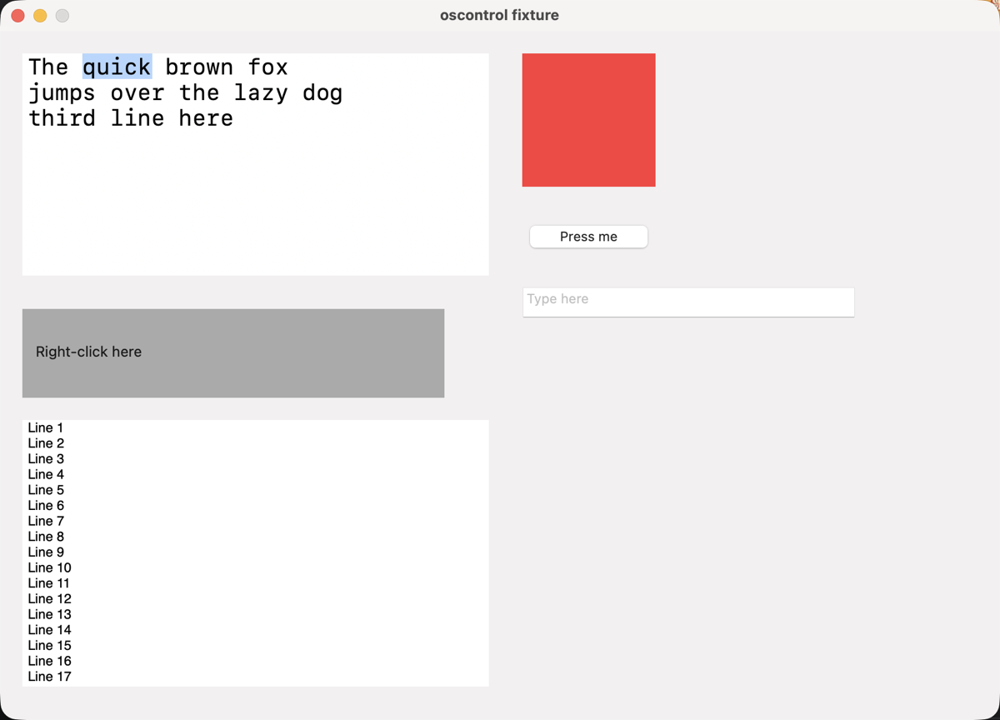

# oscontrol

**Give your AI agent eyes and hands on your Mac.**

oscontrol is a small, dependency-free macOS tool that lets an AI agent (or you, from a script) **see every screen and drive the mouse and keyboard** exactly like a person would: take a screenshot, decide where to click, click, type, drag, scroll, and check the result.

It ships as **one native binary** with two interfaces over the same code:

- a **command-line tool** for scripts, shells, and humans, and
- an **MCP server** (Model Context Protocol over stdio) that Claude Code, Kiro CLI, Pi, Agy, Grok, and any other MCP client can use directly.



> *The image above is oscontrol's own test window, captured by oscontrol. Double-clicking "quick" selected it.*

---

## Why oscontrol

- **Sees every monitor.** Captures each active display at native resolution, with exact coordinate metadata so a model can turn an image position into a click point.
- **Acts like a real user.** Clicks, double and triple clicks, right-clicks, drags, press-hold-release, scroll wheel, modifier keys (Command, Option, Control, Shift), and typing. The events look like hardware input to apps, including Electron apps such as VS Code.
- **Works with the AI tools you already use.** One MCP server, registered in one command per harness. Ready-made setup for Claude Code, Kiro CLI, Pi, Agy, and Grok. Any other MCP client works with the same JSON configuration.
- **Teaches the model how to use it.** The server sends usage guidance during the MCP handshake (coordinate conversion, screenshot-act-verify loop, macOS shortcut conventions, safety rules), so every client gets it automatically.
- **Small and inspectable.** One Swift package, no third-party dependencies, no network access, no telemetry, no background service. About 720 lines of Swift for the product.
- **Verified, not just demoed.** A 45-test end-to-end suite drives a real window through the real CLI and MCP server and checks the result.
- **Fast capture.** On a Mac with two displays, one in-process capture took about 61 ms, against about 166 ms for the system `screencapture` utility (three samples; see [Performance](#performance)).

---

## Quick start

Requirements: macOS 13 or later (tested on macOS 27.2, Apple Silicon), and the Xcode command-line tools. The package declares Swift 5.9 as its minimum; it was built with Swift 6.4.

```bash
git clone https://github.com/anfergainst/oscontrol.git
cd oscontrol
scripts/install.sh                    # builds and installs ~/.local/bin/oscontrol
oscontrol doctor                      # reports three permissions
```

Grant the permissions that `doctor` reports as missing, in **System Settings → Privacy & Security**:

- **Accessibility**: lets oscontrol click and type.
- **Screen & System Audio Recording**: lets oscontrol take screenshots.

macOS grants these to the **app that starts oscontrol**: your terminal, your IDE, or your AI tool. Grant them there and restart that app.

Then connect your AI tools:

```bash
scripts/register-harnesses.sh --dry-run   # see exactly what will be configured
scripts/register-harnesses.sh             # register with every supported harness you have
```

Your agent can now use oscontrol. Try asking it: *"Take a screenshot of all my displays and tell me what's open."*

---

## See it work: the loop an agent runs

1. **Look.** `screenshot` returns one image per display, with the position and size of each display in points.
2. **Decide.** The model finds the target in the image, for example the "Save" button.
3. **Convert.** Image position to desktop points: `x = origin_x + image_x × size_width ÷ image_width`.
4. **Act.** `mouse_click`, `type_text`, `mouse_drag`, `key_press`, `mouse_scroll`.
5. **Verify.** Take another screenshot, or read `mouse_position`, and confirm the change.

Example, using the MCP tools an agent calls:

```json
{"name": "key_press", "arguments": {"key": "n", "modifiers": ["command"]}}
```

```json
{"name": "type_text", "arguments": {"text": "I got it!"}}
```

Example, from the shell:

```bash
open -a "Visual Studio Code"; sleep 2
oscontrol key press n --modifiers command      # New File in VS Code
oscontrol type "I got it!"
oscontrol screenshot --max-width 1280 --output /tmp/check.jpg
```

---

## Features

| Area | What you get |
|---|---|
| **Screens** | List every display (origin, size in points, pixel size, scale). Capture all of them or one. JPEG or PNG, with downscaling to save tokens. |
| **Pointer** | Exact move and readback. Click with left, right, or middle button. Double-click and triple-click that select words and lines in text editors. Press, hold, move, and release. Drag with interpolated steps. |
| **Scrolling** | Scroll wheel at any point, vertical and horizontal, in pixel units. |
| **Keyboard** | Any letter, digit, or named key (`return`, `tab`, `escape`, `delete`, arrows, `home`, `end`, `f1`–`f12`). Modifiers `command`, `control`, `option`, `shift`. |
| **Typing** | Types text into the focused control, with capitals and symbols, using the same key path a person uses. |
| **Interfaces** | CLI with JSON output and clear exit codes. MCP server with 11 tools and built-in usage instructions. |
| **Diagnostics** | `doctor` reports the three macOS permissions. `benchmark` compares capture methods. `--version`. |

---

## Works with your AI harnesses

| Harness | Status | How to connect |
|---|---|---|
| **Claude Code** | Connected (verified) | `scripts/register-harnesses.sh claude` |
| **Pi** | Connected, 11 tools (verified) | `scripts/register-harnesses.sh pi` |
| **Grok CLI** | Handshake OK, 11 tools (verified) | `scripts/register-harnesses.sh grok` |
| **Agy** | Enabled (verified) | `scripts/register-harnesses.sh agy` |
| **Kiro CLI** | Registered; live session not yet tested | `scripts/register-harnesses.sh kiro-cli` |
| **Any other MCP client** | Standard MCP over stdio | Use the JSON block in [docs/harnesses/README.md](docs/harnesses/README.md#4-generic-mcp-configuration) |
| **Any shell-capable agent** | Use the CLI | Covered in [docs/llm-usage.md](docs/llm-usage.md) |

Each harness has a page with the exact command, where its configuration is stored, how to verify, and how to remove it: [docs/harnesses/](docs/harnesses/README.md).

---

## MCP tools

| Tool | What it does | Main arguments |
|---|---|---|
| `displays` | Lists monitors with origin, size, and pixel size | none |
| `screenshot` | Captures all displays, or one. Returns metadata and one image per display | `display_id`, `max_width` (default 1600), `format`, `quality` |
| `mouse_position` | Current pointer position | none |
| `mouse_move` | Moves the pointer (becomes a drag if a button is held) | `x`, `y`, `modifiers` |
| `mouse_click` | Clicks; `count` 2 = double-click, 3 = triple-click | `x`, `y`, `button`, `count`, `modifiers` |
| `mouse_down` / `mouse_up` | Holds and releases a button | `x`, `y`, `button`, `modifiers` |
| `mouse_drag` | Press, drag in steps, release | `x1`, `y1`, `x2`, `y2`, `steps`, `duration_ms`, `button`, `modifiers` |
| `mouse_scroll` | Scroll wheel; negative `delta_y` scrolls content down | `x`, `y`, `delta_y`, `delta_x`, `modifiers` |
| `key_press` | Presses one key with modifiers | `key`, `modifiers` |
| `type_text` | Types text into the focused control | `text` |

Full argument reference: [docs/harnesses/README.md](docs/harnesses/README.md#5-tools-mcp).

---

## Command line

```text
oscontrol displays
oscontrol screenshot [--display ID] [--output FILE] [--format jpeg|png] [--max-width PX] [--quality 0.78]
oscontrol mouse position
oscontrol mouse move X Y [--modifiers LIST]
oscontrol mouse click X Y [--button left|right|middle] [--count 1|2|3] [--modifiers LIST]
oscontrol mouse down X Y [--button B] [--modifiers LIST]
oscontrol mouse up X Y [--button B] [--modifiers LIST]
oscontrol mouse drag X1 Y1 X2 Y2 [--button B] [--steps N] [--duration-ms MS] [--modifiers LIST]
oscontrol mouse scroll X Y DELTA_Y [--delta-x N] [--modifiers LIST]
oscontrol key press KEY [--modifiers LIST]
oscontrol type TEXT
oscontrol doctor | permissions | benchmark [--iterations N] | mcp | version | help
```

Coordinates are **global desktop points**, origin at the top-left of the main display. Success exits with 0; errors go to stderr with exit code 1.

---

## How it works

```
   AI harness (Claude Code, Kiro, Pi, Agy, Grok, …)           Your terminal / scripts
            │  MCP over stdio (JSON-RPC 2.0)                        │  command line
            ▼                                                        ▼
   ┌───────────────────────────── oscontrol (one binary) ─────────────────────────────┐
   │   runTool(name, args)  — one dispatcher, used by both interfaces                 │
   │        │                                                                         │
   │        ├── Desktop: displays (CoreGraphics), screenshots (CGDisplayCreateImage), │
   │        │            JPEG/PNG encoding and downscaling                            │
   │        └── Input:   mouse, keyboard, scroll, drag events posted to the           │
   │                     hardware event tap (looks like real input)                  │
   └──────────────────────────────────────────────────────────────────────────────────┘
                                         │
                                         ▼
                                 macOS (WindowServer)
```

- The MCP server is a loop that reads one JSON-RPC message per line and writes one response per line. It holds no state between calls.
- Events are posted with a hardware-style event source, with real key codes and the hold times that Electron apps need.
- The binary is a copy in `~/.local/bin`, so harness configurations keep working when you rebuild or move the repository.

---

## Testing

The suite drives a deterministic test window through the public interfaces and checks what happened.

```bash
tests/e2e/run_e2e.sh              # builds and runs all 45 tests (about 2.5 minutes)
tests/e2e/run_e2e.sh --list       # list the tests
tests/e2e/run_e2e.sh --only drag  # run the tests whose names match
```

The test window has a text view, a draggable box, a button, a text field, a right-click menu, and a scroll view. It records every event it receives. Each test starts a fresh window, performs the action through `oscontrol`, and asserts on the recorded state or on pixels in the captured image.

| Area | Verified operations |
|---|---|
| Pointer | exact move and readback, hover, left/right/middle click, double and triple click, caret placement, command-click, two separate clicks |
| Selection | double-click a word, triple-click a line, drag across words, shift-click to extend, keyboard selection |
| Text | select all, copy (checked against the clipboard), paste, cut, typing with capitals and symbols, return, delete, arrow keys, option+arrow word jump, undo |
| Objects | drag an object, hold-move-release, shift-modified drag, pointer position after a drag |
| Menus | right-click opens a menu at the pointer; choose an item by mouse, by keyboard, or cancel with escape |
| Scrolling | scroll down and back up in a scroll view |
| Screens | native-resolution PNG, JPEG downscale, a pixel check that the red box appears where the window says it is, secondary-display pointer reach |
| MCP | tool list, click, drag, double-click a word, keys with modifiers, typing, screenshot image block, error handling |

The suite has been run end to end several times on the development machine; the pointer-timing caveat below applies to all of them.

---

## Performance

Measured on an Apple M5 Max with two displays (3456×2234 built-in and 1920×1080 external), with `oscontrol benchmark --iterations 3`:

| Method | Mean time |
|---|---|
| In-process capture (`CGDisplayCreateImage`), used by oscontrol | ≈ 61 ms |
| `screencapture` utility writing a file | ≈ 166 ms |

Three samples is a small sample, so run `oscontrol benchmark` on your own machine before relying on these numbers. Images are downscaled in memory (1600 px wide by default), which keeps the token cost of each screenshot low.

---

## Security and privacy

- **Local only.** oscontrol makes no network connections, collects no telemetry, and installs no background service.
- **Permissions are explicit.** It works only with the Accessibility and Screen Recording permissions you grant to the app that runs it.
- **Screenshots show everything on screen**, including private messages, email, and passwords. Close sensitive windows before giving an agent screen access.
- **Agents can click and type anywhere** the logged-in user can. Require confirmation for sensitive actions. The built-in instructions ask the model to confirm before sending, deleting, purchasing, or granting permissions, but instructions are not a security control. Review what your agent does.
- **Harness configuration is changed only through each harness's own command**, by `scripts/register-harnesses.sh`, and it can be removed with `--remove`.

---

## Limitations

- **macOS only.** Windows is planned but not started.
- **Pixel-based targeting.** Clicks use coordinates taken from screenshots. Accessibility-tree targeting (by control name) is planned.
- **Pointer events can occasionally be dropped under load.** The window server can coalesce or drop moves and drags. oscontrol re-sends the final drag position before releasing; verify important actions with `mouse position` or a screenshot.
- **Keyboard symbol mapping assumes a US layout.** Verify symbol typing on other layouts.
- **Some harnesses are not yet exercised live.** Kiro CLI and Agy are registered and verified at the configuration level; their interactive sessions still need a first real run. See the support table.
- **Apple APIs change.** `CGDisplayCreateImage` is deprecated in newer SDKs. ScreenCaptureKit is the planned successor.

---

## Roadmap

- Accessibility-tree targeting: click controls by name, not only by pixel.
- Windows support, behind the same tool interface.
- ScreenCaptureKit capture.
- Faster long-text input through the clipboard, with the user's clipboard restored.
- Continuous integration for the build (the full end-to-end suite needs a Mac with permissions granted, so it runs locally).

---

## Documentation

- [docs/harnesses/README.md](docs/harnesses/README.md): install, permissions, support matrix, tool and CLI reference, troubleshooting.
- [docs/harnesses/](docs/harnesses/): one page per harness.
- [docs/llm-usage.md](docs/llm-usage.md): instructions to give an agent so it uses oscontrol well and safely.
- [CHANGELOG.md](CHANGELOG.md): every release.
- [AGENTS.md](AGENTS.md): architecture, platform lessons, testing rules, and release process for maintainers and coding agents.

## Contributing

Issues and pull requests are welcome. Read [AGENTS.md](AGENTS.md) first: it explains the public interface contracts, the platform quirks that the code depends on, and what a change must include (tests, documentation, changelog, and three full passing test runs).

## License

No license has been chosen yet. Until a `LICENSE` file is added, all rights are reserved by the author, which means others may not copy, modify, or redistribute the code. A license is planned before the first public release.
